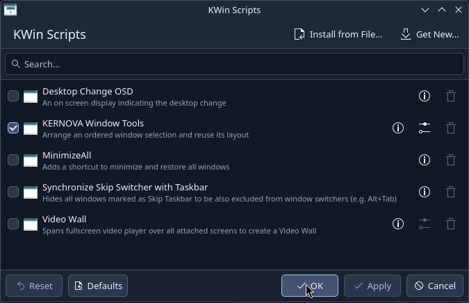
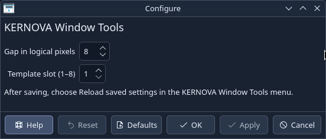

# KERNOVA Window Tools v1 testing record

The release candidate is **0.1.23**, commit `6a6ace96b9fdcaad5265c6862cb414d5eb5c90ae`, dated 21 November 2026. The authorized `dev/desktop-0.1.10` branch ran the existing [Debian 13 testing workflow](https://github.com/upnexlpd-blip/kernova-os/actions/runs/44943194700) and published the [signed prerelease](https://github.com/upnexlpd-blip/kernova-os/releases/tag/testing-v0.1.23). The stable desktop remained at 0.1.21.

## What was tested

| Environment | Observation |
| --- | --- |
| Repository | The preview metapackage requires Plasma Wayland and Xwayland. The session diagnostic checks Wayland. The standard desktop integration supplies no KERNOVA automatic tiler or Window Tools bindings. |
| Installed KERNOVA VM | Debian 13, `kwin-wayland` and `kwin-common` 4:6.3.6-1, `plasma-workspace` 4:6.3.6-2, Qt 6.8.2. The image includes KDE's Desktop Change OSD, MinimizeAll, Synchronize Skip Switcher and Video Wall scripts. |
| Independent checks | Six JavaScript cases cover preset arithmetic, geometry and ownership, overlapping/ambiguous outputs, size constraints, scripted conflicts, refusal and closure. Three persistence tests cover numbered slots, corrupted/oversized data and an interrupted atomic replacement. Debian validation also ran the existing project suite. |
| Real single display | Two resizable native Wayland windows from one process, a fixed-size Wayland window, and a resizable Xwayland window. KWin reported actual frame geometries before and after each operation. Selection order, deduplication, both presets, close, maximize/tile rejection, fixed-size rejection, full undo and preserving a manual move passed. The panel reduced the 1280 × 800 output to a 1280 × 756 work area. |
| Asynchronous refusal | The native client withheld its configure acknowledgement while the Xwayland client stayed responsive. The extension timed out and restored the verified sibling. A client may acknowledge late after a reported timeout. |
| Templates | Saved via the real session bus, unloaded and re-enabled the script, then restored using the current ordered selection. Selecting slot 5, reloading a changed gap, saving, loading and deleting were exercised with the real helper. |
| Two virtual displays | Used 100% and 125% scaling simultaneously. Presets followed the first selected window across outputs, Undo returned windows to their original connectors. Changing one resolution adapted normalized template geometry. Disabling an output left surviving windows untouched and returned the reconnect/save-new-template message. KScreen normalized a requested negative origin to zero; literal negative coordinates were covered independently. |
| Removal | With the script loaded, removing the package made the next invocation unload its resident KWin code. The user template and `kwinrc` retained identical checksums, and the desktop metapackage and KWin remained installed. |

## Activation and configuration

Existing testing users can run `sudo apt update` and `sudo apt install kernova-window-tools=0.1.23`. On a 0.1.21 installation, PackageKit's update transaction upgraded the five existing packages. First installation of the optional sixth package required an explicit install transaction. Use the [signed source enrollment procedure](https://github.com/upnexlpd-blip/kernova-os/blob/f439d92307b1d7b28e90da7acd097b9d6558dbd5/docs/smart-performance.md#install-on-an-existing-kernova-013-testing-desktop) on a machine that has only the stable archive.

Open **System Settings → Window Management → KWin Scripts**, check **KERNOVA Window Tools** and click **Apply**. In the window menu under **Extensions → KERNOVA Window Tools**, add each window in order. Choose **Side by Side** for two or **Coding layout** for three. The first window's output anchors both presets. The settings button beside the script opens the native gap and numbered slot controls.

Graphical inspection of the first 0.1.22 candidate identified a missing settings button. The superseding package uses the same fully qualified configuration plugin path as KDE's installed Video Wall script. Saving the native dialog wrote the chosen values to the user's KWin config. **Reload saved settings** reported the effective values in the running session. No compositor restart was needed.

## Signed update and measurements

In a fresh installed 0.1.21 guest, APT accepted the public testing InRelease and offered 0.1.23. PackageKit installed all six packages using the existing desktop plus one explicit first install. An independent download of each package matched the six SHA-256 entries in the release manifest. GnuPG verified the manifest with the enrolled testing key `A009 D55D F827 E047 59C2 F263 7FB7 AAA2 9B49 472F`. A second guest upgraded an already-installed Window Tools package from public 0.1.22 to public 0.1.23 through PackageKit. Its template and KWin configuration retained the same SHA-256 digests, and its previously disabled script stayed disabled.

On the VM running the published package, the same three resizable clients and one fixed client were open in each measurement. Over equal eight-second idle intervals KWin accumulated zero CPU ticks at 100 Hz in both samples. Its final resident memory readings were 313,904 KiB disabled and 314,340 KiB enabled, a difference of 436 KiB. The median round trip for seven identical KWin probe shortcuts was 2.7 ms disabled and 2.9 ms enabled, including D-Bus and the observer's polling interval. The observer saw both requested Side by Side frames after 93 ms. The extension independently waits for consecutive matching samples before reporting success. These readings describe one guest and workload.

### Remaining unverified configurations

The display tests used virtual outputs. Physical monitor hot-plug and a separate Plasma X11 login remain unverified. The refusal test used a real unresponsive Wayland client; a site-specific KWin rules file was not installed. Conflict discovery was exercised with a controlled loaded-script response. No third-party tiler was installed in the test image. All actions in the graphical driver used local session interfaces.
