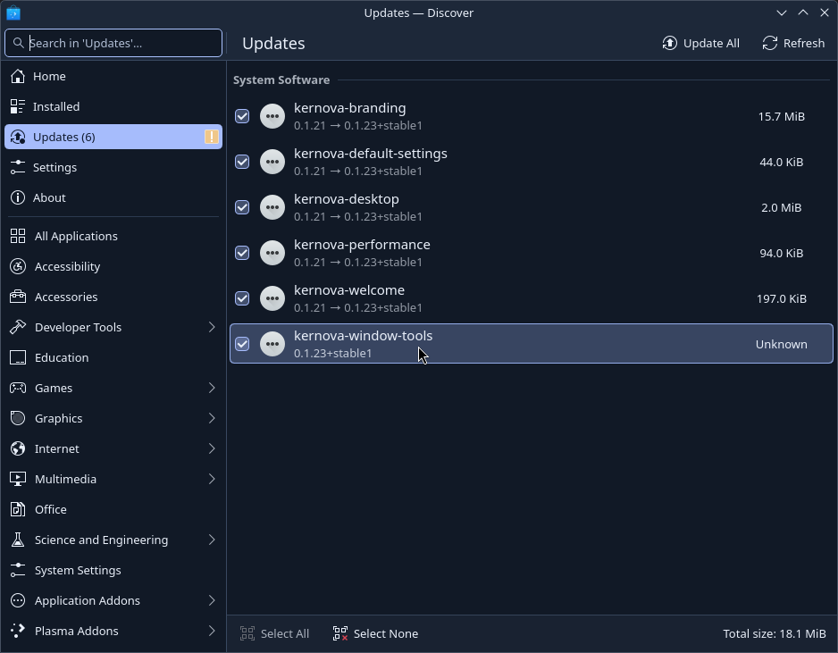

# Window Tools 0.1.23 in Discover on stable

On 21 November 2026, the standard desktop moved Window Tools from Recommends to an exact-version Depends. The Debian revision `0.1.23+stable1` sorts after the original testing package. The Window Tools implementation is identical to the 0.1.23 candidate.

The [Debian build and testing publisher](https://github.com/upnexlpd-blip/kernova-os/actions/runs/44944017844) passed. Before promotion, a disposable installed 0.1.21 UEFI guest running Debian 13 amd64 and Plasma Wayland upgraded through PackageKit with no package names supplied. It automatically installed Window Tools. The [stable publisher](https://github.com/upnexlpd-blip/kernova-os/actions/runs/44944306111) promoted those same six approved package files. An independent download verified the stable InRelease signature against the enrolled key `7656 A706 E55A 3F68 686D E0FD B9EF 5C29 B220 41E8`, its Packages index and every package against the [approved SHA-256 manifest](../../../packages/releases/0.1.23+stable1.sha256).

## Public stable upgrade

A second installed QEMU guest started at 0.1.21 with Window Tools absent and its original stable APT source enabled. The source file matched its enrolled SHA-256 digest. The testing source was disabled. After updating the stable index, Discover preselected all six KERNOVA packages. Selecting **Update All** and authenticating as the test user installed Window Tools in the same transaction as the five upgrades.



APT recorded the following transaction.

```text
Commandline: packagekit role='update-packages'
Install: kernova-window-tools:amd64 (0.1.23+stable1, automatic)
Upgrade: kernova-performance:amd64 (0.1.21, 0.1.23+stable1), kernova-default-settings:amd64 (0.1.21, 0.1.23+stable1), kernova-desktop:amd64 (0.1.21, 0.1.23+stable1), kernova-branding:amd64 (0.1.21, 0.1.23+stable1), kernova-welcome:amd64 (0.1.21, 0.1.23+stable1)
```

All six packages reported `installed` at the stable revision. `apt-mark showauto` included Window Tools. Package file verification and the pre-upgrade checksum of the user's `kwinrc` passed. KWin reported the newly installed script disabled. Enable it in **System Settings → Window Management → KWin Scripts → KERNOVA Window Tools → Apply**.

The WHPX guest paused during the warm restart. After a cold start from the same updated disk, the boot ID changed and Plasma's KWin service responded. All six packages still reported the stable version, Window Tools passed file verification, and the original KWin settings checksum matched.
